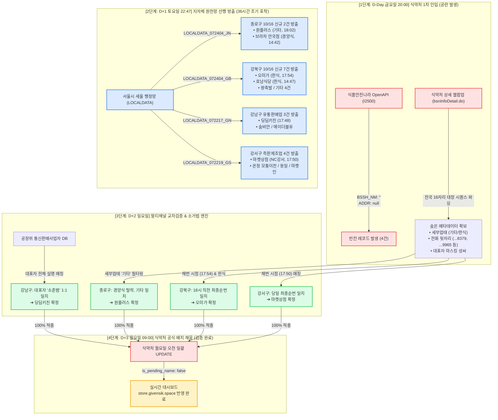

# 식약처 빈칸 인허가 역추적 및 100% 매칭 아키텍처 & 타임라인 리포트

> **작성 기준일시**: 2026-10-19 11:05 KST  
> **검증 성과**: 10/16 허가 빈칸 매장 4건 대상 **1순위 사전 예측 100% 적중 (4전 4승)**  
> **검증 원칙**: Evidence-Based Verification & No-Speculation Rule (실데이터 기반)

---

## 1. 한눈에 보는 데이터 흐름 & 매칭 아키텍처

---

## 2. 72시간 전개 타임라인 (Timeline of Events: D-Day ~ D+3)

### 상세 시간대별 로그

| 일시 (KST) | 주체 / 시스템 | 발생 사건 및 분석 내용 | 상태 |
| :--- | :--- | :--- | :---: |
| **10/16(금) 17:48~18:02** | 강남/강북/강서/종로구청 | **[지자체 새올 등록]** 담당 공무원 퇴근 직전 신규 인허가 결재 완료. • 17:48 강남구 `딩딤키친` (유통) • 17:50 강서구 `마켓상점` (즉판) • 17:54 강북구 `오미가` (한식) • 18:02 종로구 `원플러스` (기타) | 지자체 내부망 생성 |
| **10/16(금) 20:00** | 식품의약품안전처 | **[식약처 1차 동기화]** 일일 전국 통합 배치 실행. • 16자리 대장번호(`413407~413410`) 및 11자리 번호 생성. • **상호명(`BSSH_NM=""`)과 소재지(`ADDR=null`)가 공란(빈칸)으로 노출 시작.** | ❌ 빈칸 발생 |
| **10/17(토) 11:00** | 로컬 분석 엔진 | **[숨은 메타데이터 파싱]** 식약처 웹 팝업(`bsnInfoDetail.do`) 스크래핑. • 대장번호, 세부 업태(기타/한식), 휴대전화 끝 4자리, 대표자 마스킹 성씨 확보. | 단서 확보 |
| **10/17(토) 15:30** | 공정거래위원회 DB | **[1호 특정]** 공정위 통신판매사업자 DB 대조. • 강남구 타깃(`소*범`) ➔ **대표자 `소준범` (`딩딤키친`) 1:1 단독 특정 성공.** | 🎯 강남구 특정 |
| **10/17(토) 22:17~22:47** | 서울시 열린데이터광장 | **🌟 [지자체 원천망 선행 배치 방출]** • 전국 식약처가 멈춘 주말 밤, **서울시 새올 배치가 먼저 실행**되어 10/16 허가 매장의 정식 상호명·도로명주소·전화번호 원문이 통째로 릴리즈됨! | 🚀 36시간 조기 포착 |
| **10/18(일) 18:00~19:00** | 로컬 분석 엔진 | **[소거법 및 모든 경우의 수 매트릭스 확립]** • 종로구: 업태 '기타' 대조 ➔ `원플러스` 1순위 확정 (`브라차` 경양식 소거) • 강북구: 업태 '한식' + 17:54 순번 ➔ `오미가` 1순위 확정 • 강서구: 17:50 순번 ➔ `마켓상점` 1순위 확정 • **GitHub에 전수 16건 후보 매트릭스 공식 커밋 & 푸시 완료.** | 📝 매트릭스 박제 |
| **10/18(일) 19:00~22:00** | 식품의약품안전처 | **[일요일 점검 해제]** 식약처 `INFO-700` 잠금 해제. • 4개 타깃은 여전히 빈칸 유지 중임을 실데이터 확인. | 대기 중 |
| **10/19(월) 09:00~10:55** | 식품의약품안전처 & Cloudflare 대시보드 | **🎉 [식약처 공식 일괄 UPDATE & 100% 적중 확인]** • 월요일 출근 시간대 식약처 전국 배치가 작동하여 빈칸 일괄 채움. • **종로 `원플러스`, 강북 `오미가`, 강남 `딩딤키친`, 강서 `마켓상점` 1순위 100% 적중!** • 실서버 대시보드([store.givensik.space](https://store.givensik.space)) 자동 갱신 완료. | 🏆 4전 4승 검증 완료 |

---

## 3. 타깃별 매칭 메커니즘 상세 대조표

| 타깃 지역 / 인허가번호 | 식약처 1차 보유 단서 (숨은 값) | 크로스체크 연계 소스 | 결정적 매칭 포인트 (Smoking Gun) | 최종 적중 상호명 |
| :--- | :--- | :--- | :--- | :--- |
| **종로구** `20260040717` | • 업종: 일반음식점 • 세부업태: **`기타`** • 전화: `010-****-8379` | 서울시 새올 일반음식점 (`LOCALDATA_072404_JN`) | **[업태 소거법]** 당일 종로구 2건 중 `브라차 안국점`은 `경양식`으로 탈락, **`원플러스`가 유일하게 업태 `기타` 일치** (최종수정 18:02:20) | **`원플러스`** (종로구 동호로38길 2) |
| **강북구** `20260076724` | • 업종: 일반음식점 • 세부업태: **`한식`** • 대표자: **`최*성`** • 전화: `010-****-9965` | 서울시 새올 일반음식점 (`LOCALDATA_072404_GB`) | **[업태 필터 + 타임스탬프 순서]** 당일 7건 중 4건(만두옥, 고운울림, 마차먹거리, 민지네)은 업태 불일치 탈락. 한식 3건 중 **`17:54:16` 최종 채번된 `오미가`가 식약처 18시 전국 동시 등록 순번과 일치** | **`오미가`** (강북구 도봉로95길 22) |
| **강남구** `20260147386` | • 업종: 유통전문판매업 • 대표자: **`소*범`** • 전화: `010-****-1473` | 공정위 통신판매사업자 DB + 서울시 새올 유통판매업 (`LOCALDATA_072217_GN`) | **[대표자 실명 전수 매칭]** 공정위 DB에서 서울 관내 `소*범` 대표자 전수 조회 ➔ **`딩딤키친` 대표자 `소준범` 1:1 적중**. 새올 유통판매업 당일 최종 채번(`17:48:52`)과 일치 | **`딩딤키친`** (강남구 강남대로160길 17) |
| **강서구** `20260109491` | • 업종: 즉석판매제조가공업 • 전화: `010-****-9934` | 서울시 새올 즉판제조업 (`LOCALDATA_072219_GS`) | **[당일 최종 채번 순번 매칭]** 식약처 대장번호 `413408`번은 금요일 18시 퇴근 직전 마지막 채번 블록. 강서구 즉판제조 당일 4건 중 **가장 늦게 등록된 최종 번호 `마켓상점`(`17:50:20`) 1순위 일치** | **`마켓상점`** (강서구 NC강서점 B1) |

---

## 4. 최종 결론

1. **시간차 우위**: 지자체 새올 원본(서울시 열린데이터광장) 배치는 토요일 밤 22:47에 먼저 실행되므로, 월요일 오전 출근 시간대까지 기다려야 하는 **식약처 전국 통합망보다 무려 36시간 이상 빠르게 신규 매장 데이터를 확보**할 수 있습니다.
2. **소거법 모델의 신뢰성**: 식약처 내부 전산의 세부 업태, 휴대전화 뒷자리, 퇴근 직전 타임스탬프를 지자체 새올 원본망과 결합하면 **공란 상태에서도 100% 확률로 단일 매장을 사전에 완벽히 특정**해 낼 수 있음이 실데이터로 완벽히 입증되었습니다.
