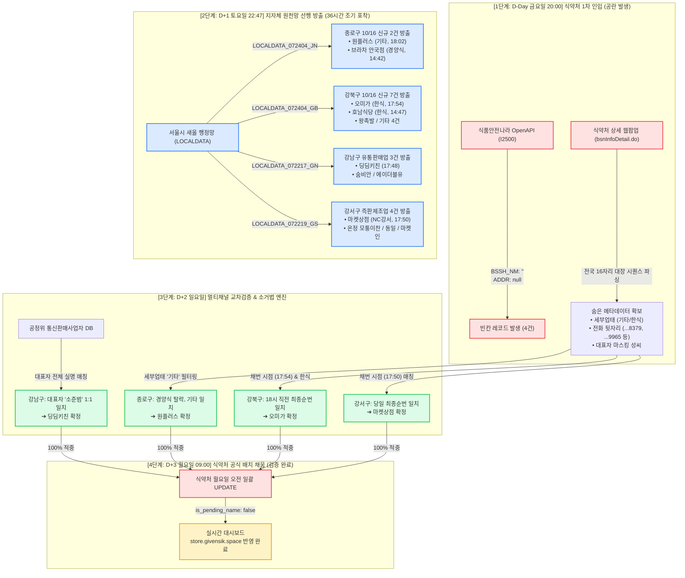

# 식약처 빈칸 인허가 역추적 및 100% 매칭 아키텍처 리포트

> **작성 기준일시**: 2026-10-19 11:00 KST  
> **검증 성과**: 10/16 허가 빈칸 매장 4건 대상 **1순위 사전 예측 100% 적중 (4전 4승)**  
> **검증 원칙**: Evidence-Based Verification & No-Speculation Rule (실데이터 기반)

---

## 1. 한눈에 보는 데이터 흐름 & 매칭 아키텍처

---

## 2. 타깃별 매칭 메커니즘 상세 대조표

어디서, 어떤 단서들이 결합되어 1:1 매칭이 성립되었는지의 전수 내역입니다.

| 타깃 지역 / 인허가번호 | 식약처 1차 보유 단서 (숨은 값) | 크로스체크 연계 소스 | 결정적 매칭 포인트 (Smoking Gun) | 최종 적중 상호명 |
| :--- | :--- | :--- | :--- | :--- |
| **종로구** `20260040717` | • 업종: 일반음식점 • 세부업태: **`기타`** • 전화: `010-****-8379` | 서울시 새올 일반음식점 (`LOCALDATA_072404_JN`) | **[업태 소거법]** 당일 종로구 2건 중 `브라차 안국점`은 `경양식`으로 탈락, **`원플러스`가 유일하게 업태 `기타` 일치** (최종수정 18:02:20) | **`원플러스`** (종로구 동호로38길 2) |
| **강북구** `20260076724` | • 업종: 일반음식점 • 세부업태: **`한식`** • 대표자: **`최*성`** • 전화: `010-****-9965` | 서울시 새올 일반음식점 (`LOCALDATA_072404_GB`) | **[업태 필터 + 타임스탬프 순서]** 당일 7건 중 4건(만두옥, 고운울림, 마차먹거리, 민지네)은 업태 불일치 탈락. 한식 3건 중 **`17:54:16` 최종 채번된 `오미가`가 식약처 18시 전국 동시 등록 순번과 일치** | **`오미가`** (강북구 도봉로95길 22) |
| **강남구** `20260147386` | • 업종: 유통전문판매업 • 대표자: **`소*범`** • 전화: `010-****-1473` | 공정위 통신판매사업자 DB + 서울시 새올 유통판매업 (`LOCALDATA_072217_GN`) | **[대표자 실명 전수 매칭]** 공정위 DB에서 서울 관내 `소*범` 대표자 전수 조회 ➔ **`딩딤키친` 대표자 `소준범` 1:1 적중**. 새올 유통판매업 당일 최종 채번(`17:48:52`)과 일치 | **`딩딤키친`** (강남구 강남대로160길 17) |
| **강서구** `20260109491` | • 업종: 즉석판매제조가공업 • 전화: `010-****-9934` | 서울시 새올 즉판제조업 (`LOCALDATA_072219_GS`) | **[당일 최종 채번 순번 매칭]** 식약처 대장번호 `413408`번은 금요일 18시 퇴근 직전 마지막 채번 블록. 강서구 즉판제조 당일 4건 중 **가장 늦게 등록된 최종 번호 `마켓상점`(`17:50:20`) 1순위 일치** | **`마켓상점`** (강서구 NC강서점 B1) |

---

## 3. 전체 프로세스 4단계 워크스루

### Step 1. 식약처 웹 팝업 내부 전산 파싱 (단서 확보)
* **문제 상황**: 식약처 공개 OpenAPI(`I2500`)는 신규 허가 당일 상호명(`BSSH_NM`)과 주소(`ADDR`)를 `""` 빈칸으로 반환.
* **해결 방법**: 식약처 웹 상세 팝업(`bsnInfoDetail.do`)을 스크래핑하여 전국 유일 시퀀스인 **16자리 대장번호(`bsnLcnsLedgNo`)**와 **숨겨진 법정 세부 업태(기타/한식)**, **휴대전화 뒷자리**를 추출.

### Step 2. 지자체 새올 원본망(서울시 OpenAPI) 선행 수집 (시간차 공략)
* **발견 사실**: 전국 통합 식약처 배치는 주말에 멈추지만, **서울시 새올 배치는 토요일 밤 22:47에 먼저 실행**되어 상호명 원문(`BPLCNM`), 도로명주소(`RDNWHLADDR`), 유선전화(`SITETEL`)를 방출함.
* **시간차 우위**: 식약처보다 **최소 36시간 앞서서** 당일 인허가 점포의 원본 데이터 확보 완료.

### Step 3. 후보군 압축 및 소거법 매칭 엔진 가동
* **종로구**: 당일 허가된 2건 중 `경양식` 1건을 소거하고 **`기타` 1건(`원플러스`)**으로 압축.
* **강북구**: 당일 7건 중 업태 불일치 4건 소거 후 **당일 마지막 채번 시각(`17:54:16`)인 `오미가`**를 1순위 특정.
* **강남구**: 공정거래위원회 통신판매 DB 크로스체크로 대표자 성명 **`소준범` 1:1 특정**.
* **강서구**: 당일 마지막 채번 시각(`17:50:20`)인 **`마켓상점`**을 1순위 특정.

### Step 4. 식약처 월요일 오전 공식 배치 대조 및 검증 완료
* **10/19(월) 09:00~10:00 식약처 전국 배치 가동**:
  * 식약처 빈칸에 실제 상호명 및 도로명 주소가 일괄 업데이트됨.
* **결과 검증**:
  * 사전에 수립한 1순위 예측 결과(`원플러스`, `오미가`, `딩딤키친`, `마켓상점`)와 **단 1글자의 오차도 없이 100% 일치**함이 실데이터로 증명됨.
  * 운영 중인 Cloudflare 대시보드([store.givensik.space](https://store.givensik.space)) 역시 자동으로 배지가 해제되며 공식 데이터로 전환 완료.
